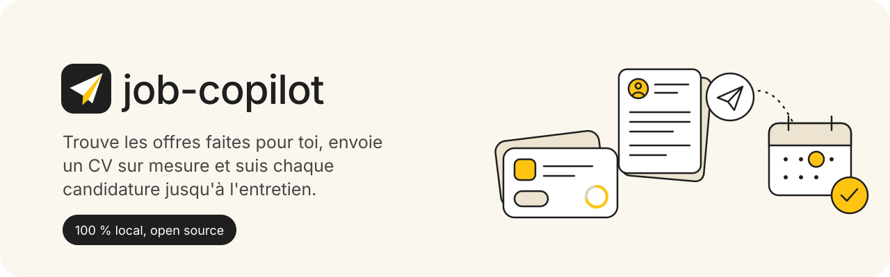
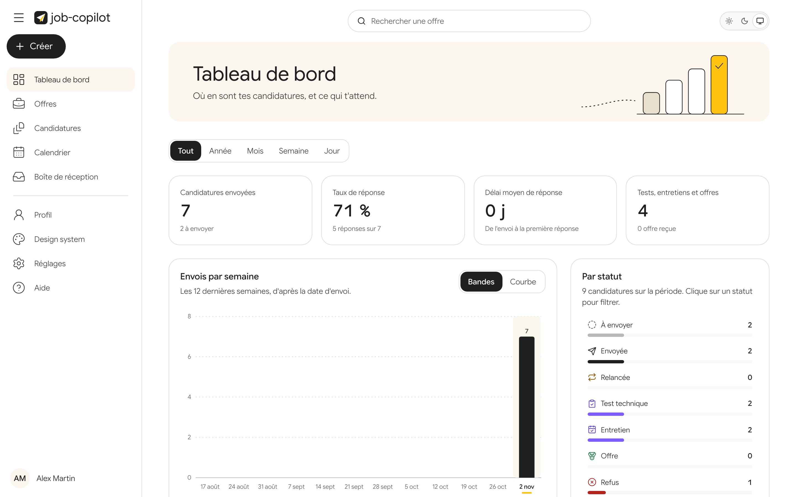
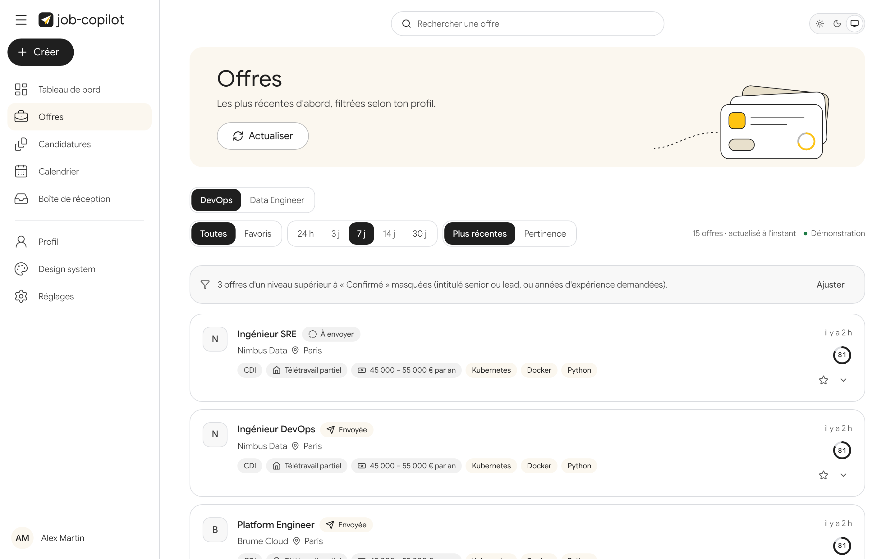
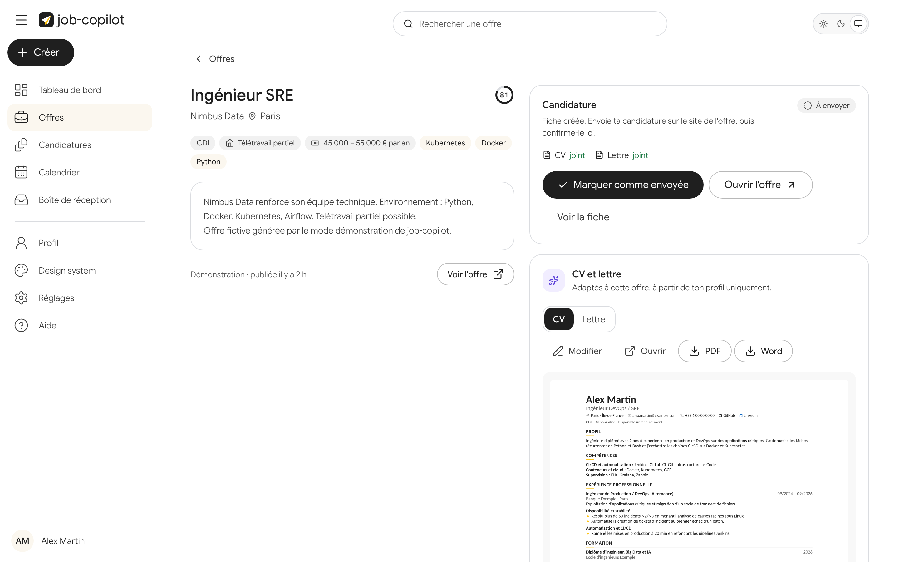
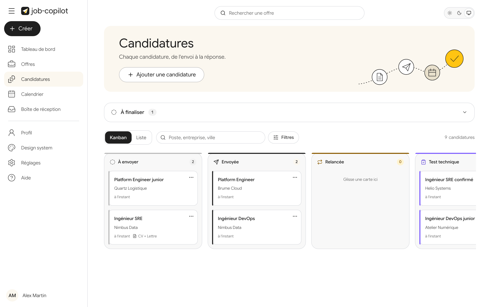
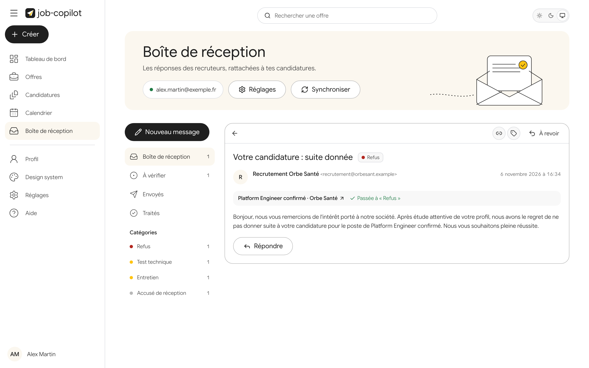
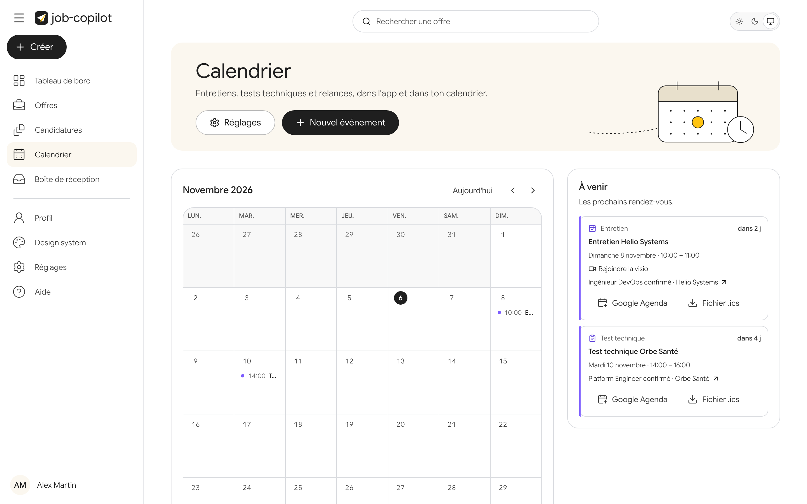
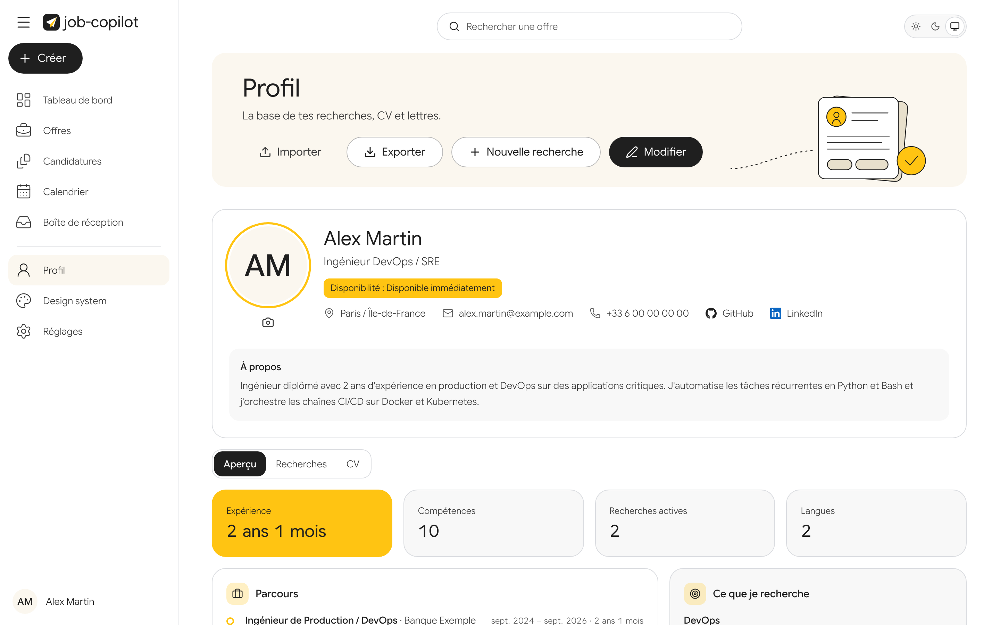
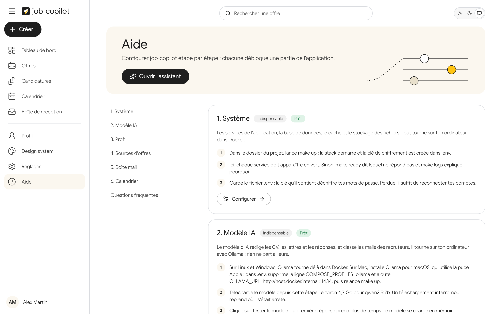
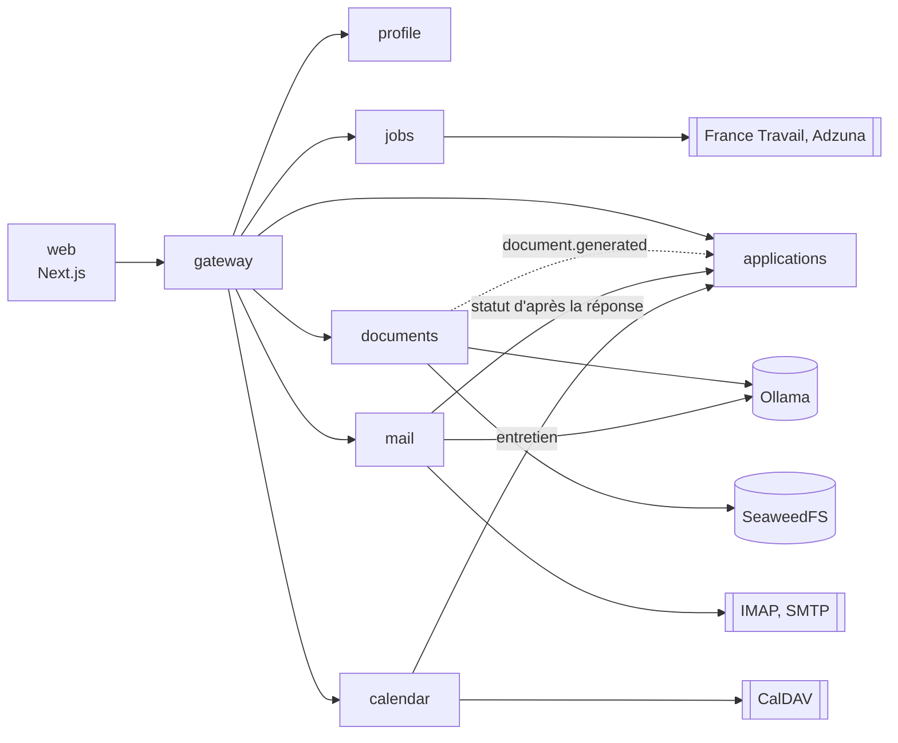

<p align="center">
  
</p>

<p align="center">
  <a href="https://github.com/CyrilleAdrien/job-copilot/actions/workflows/ci.yml"></a>
  <a href="LICENSE"></a>
</p>

job-copilot est un assistant de candidature qui s'installe sur ton ordinateur. Il cherche les offres qui correspondent à ton profil, écrit un CV et une lettre adaptés à chacune avec un LLM local, puis suit chaque candidature : envoi, réponses du recruteur, entretiens.

- **Local** : profil, CV, mails et candidatures restent sur ta machine. Pas de compte, pas de serveur central.
- **Semi-automatique** : l'outil prépare tout, tu valides chaque envoi. Aucun bot sur LinkedIn ou Indeed.
- **Gratuit** : LLM local avec Ollama, APIs d'offres gratuites, briques open source.



## Ce que fait l'outil

| | |
| --- | --- |
|  |  |
| **Offres.** Collectées sur France Travail et Adzuna, dédoublonnées, filtrées par recherche (DevOps, Data Engineer...) et classées par date ou par pertinence. | **CV et lettre.** Le LLM choisit et reformule tes expériences pour l'offre, sans rien inventer, puis Typst met en page le PDF. Tu relis et modifies avant d'envoyer. |
|  |  |
| **Candidatures.** Une fiche par candidature, un Kanban des statuts, les relances à faire. | **Boîte de réception.** Les réponses des recruteurs sont lues en IMAP, rattachées à la bonne candidature et classées (refus, entretien, test...). |
|  |  |
| **Calendrier.** Les entretiens, synchronisés en CalDAV avec iCloud ou Google, et un flux `.ics`. | **Profil.** Toutes les sections d'un CV, plusieurs recherches, import et export en `profile.yaml`. |

Le détail de chaque écran et de l'API est dans le [guide d'utilisation](docs/guide.md).

## Installation pas à pas

### 1. Vérifier la machine

- **Mémoire** : 16 Go de RAM conseillés. Le modèle par défaut (Qwen 2.5 7B) demande environ 8 Go libres.
- **Disque** : environ 15 Go libres, dont 4,7 Go pour le modèle et 7 Go pour l'image Ollama sous Linux et Windows (moitié moins sur Mac, où Ollama s'installe à part).
- **Système** : macOS, Linux, ou Windows 10 et 11 avec WSL 2.

### 2. Installer les outils

| Système | À installer |
| --- | --- |
| macOS | [Docker Desktop](https://www.docker.com/products/docker-desktop/), puis [Ollama pour macOS](https://ollama.com/download) (voir l'étape 4). `git`, `make` et `openssl` sont fournis avec les outils en ligne de commande d'Apple : `xcode-select --install`. |
| Linux | [Docker Engine](https://docs.docker.com/engine/install/) avec le plugin Compose, puis `git`, `make` et `openssl` (par exemple `sudo apt install git make openssl`). |
| Windows | [WSL 2](https://learn.microsoft.com/fr-fr/windows/wsl/install) avec Ubuntu (`wsl --install` dans PowerShell), puis [Docker Desktop](https://www.docker.com/products/docker-desktop/) avec l'intégration WSL activée. Toutes les commandes suivantes se tapent dans le terminal Ubuntu, après `sudo apt install git make openssl`. |

Vérifie que Docker répond :

```bash
docker compose version
```

### 3. Récupérer le projet

```bash
git clone https://github.com/CyrilleAdrien/job-copilot.git
cd job-copilot
cp .env.example .env
```

Le fichier `.env` garde ta configuration locale. Il n'est jamais versionné.

### 4. Choisir où tourne le LLM

- **Linux et Windows** : rien à faire. Ollama tourne dans un conteneur.
- **macOS** : Docker n'a pas accès au GPU Apple, et un modèle 7B mettrait plusieurs minutes par réponse. Installe Ollama pour macOS et lance-le une fois. Ensuite, dans `.env`, supprime la ligne `COMPOSE_PROFILES=ollama` et décommente `OLLAMA_URL=http://host.docker.internal:11434`.

### 5. Démarrer

```bash
make up       # crée la clé de chiffrement, construit et démarre la stack (quelques minutes la première fois)
make ready    # état de chaque service : "status": "ok" partout
```

### 6. Laisser l'assistant te guider

Va sur http://job-copilot.localhost:3000 (Chrome, Edge, Firefox) ou http://localhost:3000 (Safari). Au premier lancement, l'assistant de configuration s'ouvre et propose deux chemins :

- **Configurer l'outil** : les étapes s'enchaînent dans l'ordre, chacune avec son mode d'emploi. Le système est vérifié, le modèle d'IA se télécharge depuis l'interface (environ 4,7 Go ; `make models` fait la même chose en ligne de commande), puis tu remplis ton profil ou importes un `profile.yaml`. Les sources d'offres, la boîte mail et le calendrier sont facultatifs : chacun débloque l'écran qui en dépend.
- **Essayer en démonstration** : un profil d'exemple, des offres, des réponses de recruteurs et un calendrier fictifs, sans compte ni IA. Le bouton « Démonstration · Quitter », en haut de l'écran, efface ces données et ramène à l'assistant.

| Étape | Où s'inscrire | Indispensable |
| --- | --- | --- |
| Système et modèle d'IA | rien : tout tourne sur ta machine | oui |
| Profil | rien | oui |
| Offres France Travail | [francetravail.io](https://francetravail.io), application avec l'API « Offres d'emploi v2 » | non, mais il faut au moins une source pour voir des offres |
| Offres Adzuna | [developer.adzuna.com](https://developer.adzuna.com) | non |
| Boîte mail | un mot de passe d'application Gmail, Outlook ou iCloud | non |
| Calendrier | un mot de passe d'application iCloud, ou un serveur CalDAV | non |



Les clés et les mots de passe sont testés, puis chiffrés en base avec la clé de ton `.env` ; ils ne sont jamais écrits ailleurs. La page **Aide** de l'application reprend chaque étape en détail, avec les instructions de chaque fournisseur, et **Réglages** permet de tout modifier ensuite.

Pour la boîte mail, l'application lit les mails reçus et les analyse sur ton ordinateur, avec ton IA locale. Pour respecter la vie privée de tes contacts (RGPD), utilise de préférence une adresse dédiée à tes candidatures.

### Au quotidien

```bash
make down              # arrête tout ; les données restent dans les volumes Docker
make up                # redémarre
git pull && make up    # met à jour
```

Pour tout effacer, utilise **Réglages > Mes données > Tout supprimer**. Exporte d'abord une archive `.zip` si tu veux garder une copie.

### En cas de souci

| Symptôme | Piste |
| --- | --- |
| La page ne s'ouvre pas | `make ready` indique quel service ne répond pas, et `make logs` explique pourquoi. |
| `job-copilot.localhost` introuvable | Ton navigateur ne reconnaît pas cette adresse : utilise http://localhost:3000. |
| Un port est déjà pris | Change `WEB_PORT` ou `GATEWAY_PORT` dans `.env`, puis `make up`. |
| La génération est très lente sur Mac | Ollama tourne dans Docker sans GPU : reprends l'étape 4. |
| La génération du CV échoue | Le modèle n'est peut-être pas téléchargé : Réglages, étape Modèle IA, bouton Télécharger, puis Tester le modèle. |

## Architecture

Six services FastAPI derrière une gateway, avec une interface Next.js. Ils partagent Postgres (un schéma par service), Redis (cache et événements), un stockage S3 local (SeaweedFS) et Ollama. Seuls `web` et `gateway` sont exposés, sur `127.0.0.1`.



Le schéma complet, les événements et les choix techniques sont dans [docs/architecture.md](docs/architecture.md). La carte des données et des écrans qui en dépendent est dans [docs/relations.md](docs/relations.md).

## Développement

Prérequis en plus de Docker : [uv](https://docs.astral.sh/uv/) et Node.js 22.

```bash
make setup        # .env, environnement Python et dépendances du front
make test-db      # Postgres jetable pour les tests, une fois
make lint
make test
make web          # front en mode développement
make e2e          # parcours complet Playwright sur une stack jetable
make screenshots  # régénère les captures de ce README
```

`make e2e` et `make screenshots` lancent une stack à part (projet `job-copilot-e2e`, ports 3100 et 8100), en mode démonstration, puis la détruisent. Tes données ne sont pas touchées, et le parcours refuse de démarrer sur une stack qui contient déjà des données.

```
web/                 interface Next.js (design system dans src/components/ui, parcours dans e2e)
libs/common/         configuration et health checks partagés
services/<nom>/      un service FastAPI par dossier, avec ses migrations Alembic
services/Dockerfile  image commune aux services
infra/               initialisation de Postgres, configuration de la stack e2e
examples/            profil d'exemple au format YAML
docs/                guide, architecture, captures
```

Le style graphique s'inspire de Kaggle : police Google Sans Flex, boutons noirs, crème et jaune d'or, illustrations propres au projet, violet réservé à ce qui vient de l'IA, mode sombre natif, icônes Lucide. Les animations respectent `prefers-reduced-motion`. Les tokens sont dans `web/src/app/globals.css`.

## Licence

[PolyForm Noncommercial 1.0.0](LICENSE) : tu peux utiliser, étudier et modifier job-copilot pour un usage personnel ou non commercial (recherche d'emploi, étude, recherche, association, organisme public). Toute utilisation commerciale, revente ou intégration dans un produit ou un service payant demande l'accord écrit de l'auteur.

Copyright (c) 2026 Cyrille FOTSO.
