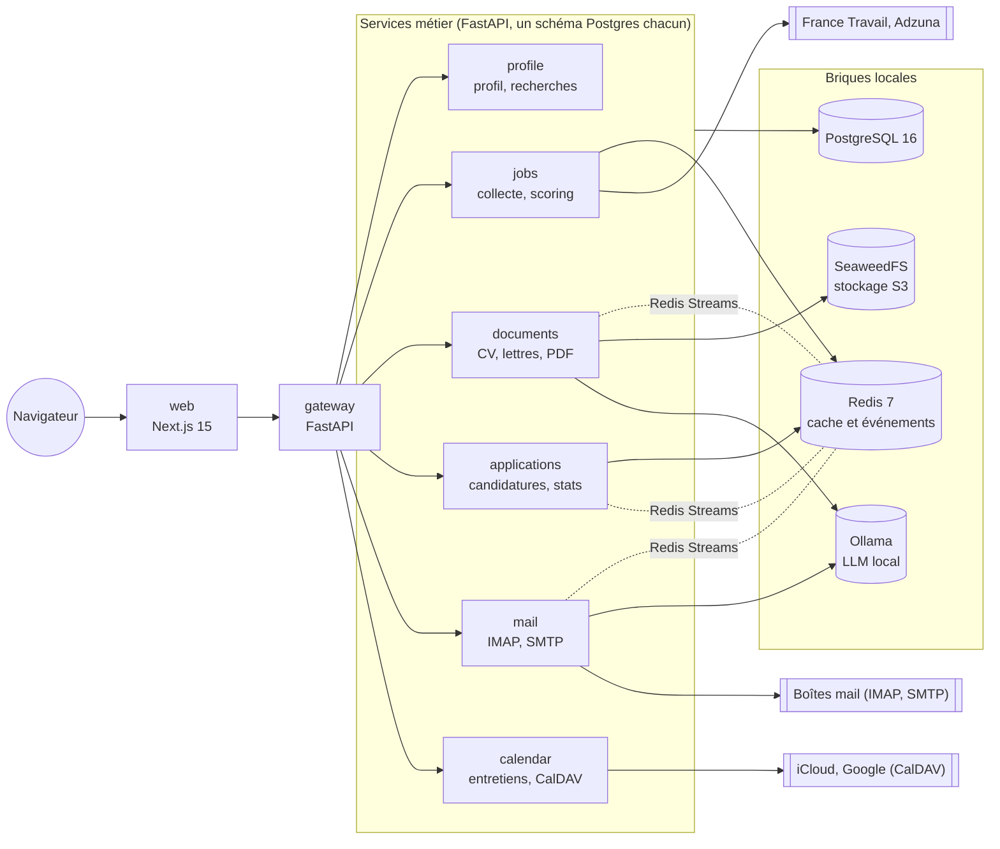
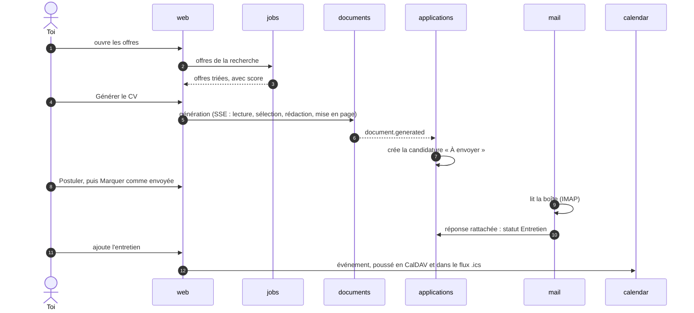

# Architecture

job-copilot tourne entièrement sur ta machine, lancé par un seul `docker compose up`. Six services métier se placent derrière une gateway et partagent quatre briques locales. Seuls `web` et `gateway` sont publiés, sur `127.0.0.1` uniquement. Les autres services ne sont joignables que dans le réseau Docker interne.

Seuls `jobs`, `mail` et `calendar` sortent vers Internet, et uniquement vers les services que tu as configurés.

## Services

| Service | Rôle | Données |
| --- | --- | --- |
| `web` | Interface Next.js, seul point d'entrée pour l'utilisateur (`127.0.0.1:3000`) | aucune |
| `gateway` | API REST unique (`127.0.0.1:8000`) : routage vers les services, contrôle d'origine, flux SSE, export et suppression de toutes les données | aucune |
| `profile` | Profil, expériences, recherches, mise en page du CV par recherche, photo | schéma `profile` |
| `jobs` | Collecte France Travail et Adzuna, dédoublonnage, score de pertinence, favoris | schéma `jobs`, cache Redis |
| `documents` | Génération du CV et de la lettre (LLM puis Typst), versions, aperçus | schéma `documents`, bucket S3 |
| `applications` | Candidatures, statuts, historique, statistiques du tableau de bord | schéma `applications`, cache Redis |
| `mail` | Lecture IMAP, rattachement et classement des réponses, envoi SMTP | schéma `mail` |
| `calendar` | Entretiens, synchro CalDAV, flux `.ics` | schéma `calendar` |

Un service ne lit jamais le schéma d'un autre : il passe par son API, ou par un événement. Les liens entre schémas se font par identifiant, sans clé étrangère croisée. Chaque service a ses migrations Alembic.

## Événements

Les traitements qui ne doivent pas bloquer passent par Redis Streams :

| Événement | Émis par | Effet |
| --- | --- | --- |
| `document.generated` | documents | applications, avec son groupe de lecture, joint le CV et la lettre, et crée la candidature si elle n'existe pas |
| `application.created`, `application.status_changed` | applications | publiés pour de futurs consommateurs ; aucun service ne les lit encore |
| `mail.classified` | mail | publié pour de futurs consommateurs ; le statut de la candidature, lui, change par un appel HTTP de mail vers applications |

## Une candidature, de bout en bout

## Choix techniques

| Couche | Choix |
| --- | --- |
| Front | Next.js 15 (App Router), TypeScript, Tailwind CSS, Radix UI, TanStack Query, Motion, Lucide |
| Back | Python 3.12, FastAPI, Pydantic v2, SQLAlchemy 2 async, Alembic, monorepo uv |
| LLM | Ollama (Qwen 2.5 7B par défaut), sortie JSON validée par Pydantic |
| PDF | Typst |
| Mail et agenda | IMAP, SMTP, CalDAV, iCalendar : protocoles ouverts, sans OAuth |
| Qualité | pytest, Vitest, Playwright, Ruff, ESLint, GitHub Actions |

La carte détaillée des données, de leurs propriétaires et des écrans qui en dépendent est dans [relations.md](relations.md).
