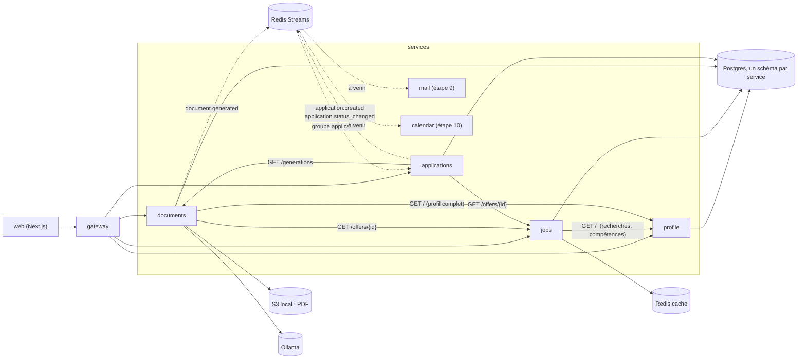
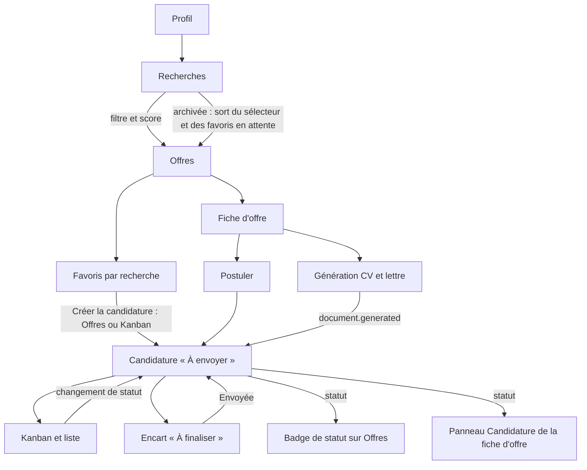

# Relations entre fonctionnalités et services

Cette page sert de carte avant toute modification : elle dit quel service possède quelle donnée, qui la lit, et quels écrans doivent refléter un changement. À tenir à jour à chaque étape.

## Services et flux

Flèche pleine : appel HTTP synchrone. Pointillés : événement Redis Streams.

## Données et propriétaires

| Donnée | Service propriétaire | Lue par |
| --- | --- | --- |
| Profil, recherches (actives ou archivées), niveau visé | profile | jobs (filtres, score), documents (CV), web (Profil, sélecteur d'Offres, filtre « Recherche d'origine ») |
| Offres, score, favoris par recherche | jobs | web (Offres, fiche d'offre, Candidatures : favoris sans candidature), documents, applications |
| CV et lettres générés (versions, PDF) | documents | applications (dernier CV et dernière lettre), web (fiche d'offre, fiche de candidature) |
| Candidatures, statuts, historique | applications | web (Candidatures, badge de statut sur Offres, panneau Candidature de la fiche d'offre), mail et calendar à venir |

## Arbre des fonctionnalités

## Ce qu'il faut revérifier après un changement

| Si tu modifies... | Vérifie aussi |
| --- | --- |
| Une recherche (création, archivage, suppression) | sélecteur d'Offres, favoris en attente du Kanban, filtre « Recherche d'origine » |
| Un favori (ajout, retrait) | vue Favoris d'Offres, colonne « À envoyer » du Kanban (favoris sans candidature) |
| La création d'une candidature | badge sur la carte d'offre, panneau de la fiche d'offre, Kanban, « À finaliser », compteurs des filtres, favori retiré des favoris en attente |
| Un statut de candidature | colonne du Kanban, « À finaliser », badge sur Offres, historique de la fiche, événement `application.status_changed` |
| La suppression d'une candidature | le favori réapparaît dans « À envoyer », le badge disparaît d'Offres |
| Une génération de documents | fiche d'offre, fiche de candidature (CV et lettre joints), état CV / Lettre dans « À finaliser » |
| Le schéma d'un service | migration Alembic, schémas Pydantic, types TypeScript dans `web/src/lib/` |
