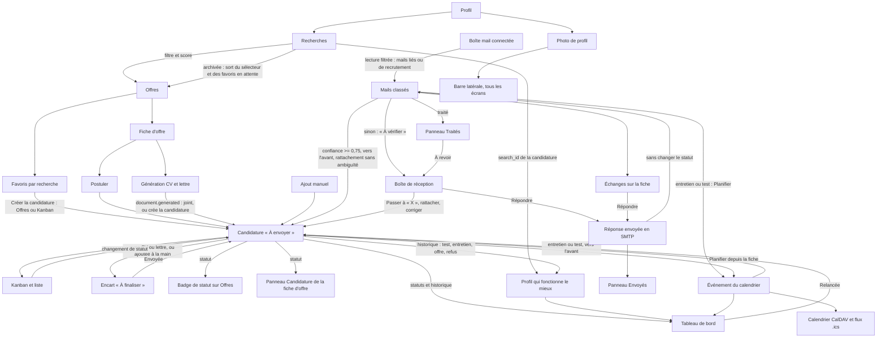

# Relations entre fonctionnalités et services

Cette page sert de carte avant toute modification : elle dit quel service possède quelle donnée, qui la lit, et quels écrans doivent refléter un changement. À tenir à jour à chaque étape.

## Services et flux

```mermaid
flowchart LR
  web["web (Next.js)"] --> gateway

  subgraph services
    profile
    jobs
    documents
    applications
    mail
    calendar
  end

  gateway --> profile & jobs & documents & applications & mail & calendar

  jobs -- "GET /  (recherches, compétences)" --> profile
  documents -- "GET /  (profil complet)" --> profile
  documents -- "GET /offers/{id}" --> jobs
  applications -- "GET /offers/{id}" --> jobs
  applications -- "GET /generations" --> documents
  mail -- "GET /applications (rattachement)<br/>PATCH statut, source mail" --> applications
  mail -- "IMAP, lecture seule,<br/>toutes les 15 min" --> imap[(Boîtes mail)]
  mail -- "SMTP chiffré : réponse,<br/>au clic sur Envoyer" --> smtp[(Destinataires)]
  mail --> ollama
  calendar -- "GET /applications/{id}<br/>PATCH statut (entretien, test)" --> applications
  calendar -- "CalDAV : PUT, DELETE<br/>(iCloud, autre serveur)" --> caldav[(Calendrier distant)]
  calendar -- "flux .ics (webcal)" --> apple[(Calendrier sur Mac,<br/>Thunderbird)]

  documents -. "document.generated" .-> redis[(Redis Streams)]
  redis -. "groupe applications :<br/>joint les documents,<br/>crée la candidature si besoin" .-> applications
  applications -. "application.created<br/>application.status_changed" .-> redis
  mail -. "mail.classified" .-> redis

  applications --> statscache[(Redis : statistiques,<br/>vidées à chaque modification)]
  profile & jobs & documents & applications & mail & calendar --> pg[(Postgres, un schéma par service)]
  jobs --> cache[(Redis cache)]
  documents --> s3[(S3 local : PDF)]
  documents --> ollama[(Ollama)]
```

Flèche pleine : appel HTTP synchrone. Pointillés : événement Redis Streams.

## Données et propriétaires

| Donnée | Service propriétaire | Lue par |
| --- | --- | --- |
| Profil, recherches (actives ou archivées), niveau visé | profile | jobs (filtres, score), documents (CV), web (Profil, sélecteur d'Offres, filtre « Recherche d'origine ») |
| Photo de profil (à part du profil : absente de `GET /` et du YAML, supprimée avec le profil) | profile | web (barre latérale sur tous les écrans, écran Profil, panneau Envoyés de la Boîte de réception) |
| Offres, score, favoris par recherche | jobs | web (Offres, fiche d'offre, Candidatures : favoris sans candidature), documents, applications |
| CV et lettres générés (versions, PDF) | documents | applications (dernier CV et dernière lettre), web (fiche d'offre, fiche de candidature) |
| Candidatures, statuts, historique | applications | web (Candidatures, badge de statut sur Offres, panneau Candidature de la fiche d'offre), mail (rattachement, statut d'après un mail), calendar (titre, statut à faire avancer) |
| Boîtes mail (mot de passe chiffré avec `SECRET_KEY`, utilisé en IMAP et en SMTP), mails gardés, catégorie, candidature liée, réponses envoyées | mail | web (Boîte de réception, section Échanges de la fiche de candidature) |
| Événements (entretien, test technique, relance, rendez-vous), calendrier CalDAV connecté (mot de passe chiffré) | calendar | web (Calendrier, section Entretiens de la fiche, Prochains rendez-vous du tableau de bord), Calendrier sur Mac par le flux .ics, Google Agenda par lien ou import |
| Statistiques du tableau de bord (`GET /stats`), dont les retours par recherche | applications, calculées depuis les candidatures et leur historique, en cache Redis 15 min | web (Tableau de bord ; noms des recherches lus dans profile) |
| Export `.zip` et suppression de tout (`/api/data`, écran Réglages) | gateway, qui réunit `/data/export` et `/data` de chaque service | web (Réglages) |

## Arbre des fonctionnalités

## Ce qu'il faut revérifier après un changement

| Si tu modifies... | Vérifie aussi |
| --- | --- |
| Une recherche (création, archivage, suppression) | sélecteur d'Offres, favoris en attente du Kanban, filtre « Recherche d'origine » |
| Un favori (ajout, retrait) | vue Favoris d'Offres, colonne « À envoyer » du Kanban (favoris sans candidature) |
| La création d'une candidature | badge sur la carte d'offre, panneau de la fiche d'offre, Kanban, « À finaliser », compteurs des filtres, favori retiré des favoris en attente |
| Un statut de candidature | colonne du Kanban, « À finaliser », badge sur Offres, historique de la fiche, événement `application.status_changed`, chiffres et relances du tableau de bord (cache vidé) |
| Une relance (`POST /applications/{id}/follow-up`) | la ligne quitte « Relances à faire », colonne Relancée du Kanban, historique de la fiche |
| Le calcul des statistiques | tableau de bord, et chaque écriture du service applications doit vider le cache (`stats.invalidate`) |
| La suppression d'une candidature | le favori réapparaît dans « À envoyer », le badge disparaît d'Offres, chiffres du tableau de bord |
| Une génération de documents | fiche d'offre, fiche de candidature (CV et lettre joints), candidature créée « À envoyer » si l'offre n'en avait pas, entrée dans « À finaliser », badge sur Offres, favori retiré des favoris en attente |
| La liste des statuts | `Status` et `STATUSES` (schemas.py), `RESPONSES` et `PROGRESS` (stats.py), `lib/statuses.ts` et `statusOrder` (web) : colonnes du Kanban, filtres, tableau de bord |
| Une recherche renommée | noms affichés dans l'analyse par profil et dans le filtre « Recherche d'origine » (l'identifiant ne change pas) |
| La lecture des mails (rattachement, classement, statut automatique) | Boîte de réception (« À vérifier », catégories), statut et historique de la fiche (« d'après un mail »), Kanban, tableau de bord (cache vidé par le PATCH), Échanges de la fiche ; une seconde lecture ne crée pas de doublon |
| Un mail rattaché, détaché ou recatégorisé | section Échanges de la fiche, bouton « Passer à » (statut proposé) |
| La photo de profil (`PUT` ou `DELETE /photo`) | avatar de la barre latérale sur tous les écrans, carte de l'écran Profil, panneau Envoyés ; le profil, le YAML, les CV et les autres services ne changent pas |
| Un mail traité ou remis à revoir | onglet « À vérifier » et panneau Traités de la Boîte de réception |
| L'état d'une boîte (`last_error`) | témoin vert ou rouge du panneau de droite, icône du bouton Réglages |
| L'envoi d'une boîte (`smtp_host`, `smtp_port`, `smtp_error`) | test à la connexion, réglages de la boîte de réception, ligne d'erreur du panneau de droite ; une panne d'envoi ne bloque pas la lecture ni le témoin de lecture |
| L'état d'une réponse (`sending`, `sent`, `failed`, `uncertain`) | un essai `failed` n'apparaît nulle part et réessaie avec le même Message-ID ; `uncertain` s'affiche dans la Boîte de réception, le panneau Envoyés et les Échanges de la fiche, sans traiter le mail ; un `sending` trouvé au démarrage devient `uncertain` |
| Une réponse à un mail (`POST /messages/{id}/reply`) | ligne de la Boîte de réception, panneaux Envoyés et Traités, section Échanges de la fiche ; le mail quitte « À vérifier » s'il est rattaché sans statut à confirmer ; statut, Kanban, tableau de bord et calendrier ne changent pas ; une seconde lecture n'y touche pas |
| Les fournisseurs de messagerie (`PROVIDERS`, api.py) | formulaire de connexion : serveur, texte d'aide, étapes et liens du bouton « Aide » ; serveur d'envoi (`KNOWN_SERVERS`, outbox.py) |
| Une boîte déconnectée | ses mails et ses réponses enregistrées disparaissent de la Boîte de réception et des Échanges ; les statuts déjà appliqués et les mails déjà partis restent |
| Un événement (création, modification, suppression) | grille et « À venir » du Calendrier, section Entretiens de la fiche, Prochains rendez-vous du tableau de bord, copie CalDAV (PUT ou DELETE, SEQUENCE incrémenté), flux .ics ; à la création, statut de la candidature et chiffres du tableau de bord |
| Le calendrier connecté (connexion, déconnexion) | les événements à venir y sont recopiés à la connexion ; à la déconnexion, ils restent dans le calendrier distant |
| Une candidature supprimée | ses événements restent dans le calendrier, sans lien vers la fiche |
| Une table d'un service | l'export et la suppression la couvrent d'office ; une colonne dont le nom contient `password`, `secret`, `token` ou `api_key`, ou binaire, reste hors de l'export ; ce qui vit hors de Postgres (S3, Redis) passe par les fonctions de `main.py` de chaque service, et un nouveau flux Redis doit y être ajouté |
| La suppression de toutes les données (`DELETE /api/data`) | base, bucket S3 et clés Redis vides ; groupes de lecture des flux conservés, donc une nouvelle génération crée toujours sa candidature ; boîte mail et calendrier distants intacts ; `make e2e` le vérifie |
| Une route ou un écran du parcours principal | `web/e2e/parcours.spec.ts`, lancé par `make e2e` et en CI |
| Le schéma d'un service | migration Alembic, schémas Pydantic, types TypeScript dans `web/src/lib/` |
