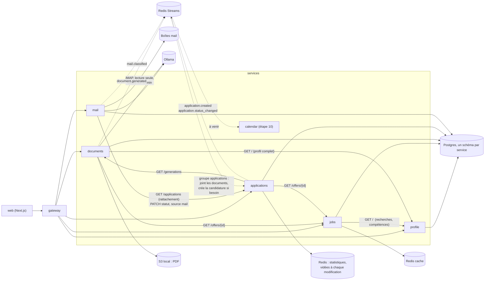
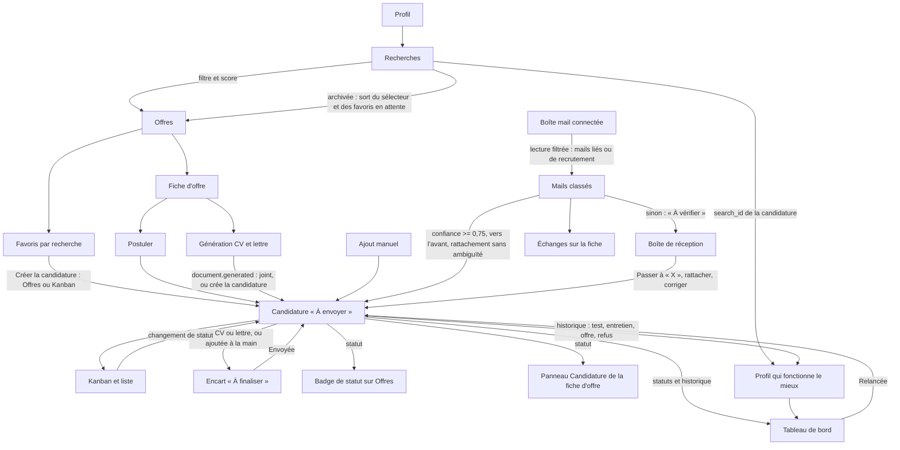

# Relations entre fonctionnalités et services

Cette page sert de carte avant toute modification : elle dit quel service possède quelle donnée, qui la lit, et quels écrans doivent refléter un changement. À tenir à jour à chaque étape.

## Services et flux

Flèche pleine : appel HTTP synchrone. Pointillés : événement Redis Streams.

## Données et propriétaires

| Donnée | Service propriétaire | Lue par |
| --- | --- | --- |
| Profil, recherches (actives ou archivées), niveau visé | profile | jobs (filtres, score), documents (CV), web (Profil, sélecteur d'Offres, filtre « Recherche d'origine ») |
| Offres, score, favoris par recherche | jobs | web (Offres, fiche d'offre, Candidatures : favoris sans candidature), documents, applications |
| CV et lettres générés (versions, PDF) | documents | applications (dernier CV et dernière lettre), web (fiche d'offre, fiche de candidature) |
| Candidatures, statuts, historique | applications | web (Candidatures, badge de statut sur Offres, panneau Candidature de la fiche d'offre), mail (rattachement, statut d'après un mail), calendar à venir |
| Boîtes mail (mot de passe chiffré avec `SECRET_KEY`), mails gardés, catégorie, candidature liée | mail | web (Boîte de réception, section Échanges de la fiche de candidature) |
| Statistiques du tableau de bord (`GET /stats`), dont les retours par recherche | applications, calculées depuis les candidatures et leur historique, en cache Redis 15 min | web (Tableau de bord ; noms des recherches lus dans profile) |

## Arbre des fonctionnalités

## Ce qu'il faut revérifier après un changement

| Si tu modifies... | Vérifie aussi |
| --- | --- |
| Une recherche (création, archivage, suppression) | sélecteur d'Offres, favoris en attente du Kanban, filtre « Recherche d'origine » |
| Un favori (ajout, retrait) | vue Favoris d'Offres, colonne « À envoyer » du Kanban (favoris sans candidature) |
| La création d'une candidature | badge sur la carte d'offre, panneau de la fiche d'offre, Kanban, « À finaliser », compteurs des filtres, favori retiré des favoris en attente |
| Un statut de candidature | colonne du Kanban, « À finaliser », badge sur Offres, historique de la fiche, événement `application.status_changed`, chiffres et relances du tableau de bord (cache vidé) |
| Une relance (`POST /applications/{id}/follow-up`) | la ligne quitte « Relances à faire », colonne Relancée du Kanban, historique de la fiche |
| Le calcul des statistiques | tableau de bord, et chaque écriture du service applications doit vider le cache (`stats.invalidate`) |
| La suppression d'une candidature | le favori réapparaît dans « À envoyer », le badge disparaît d'Offres, chiffres du tableau de bord |
| Une génération de documents | fiche d'offre, fiche de candidature (CV et lettre joints), candidature créée « À envoyer » si l'offre n'en avait pas, entrée dans « À finaliser », badge sur Offres, favori retiré des favoris en attente |
| La liste des statuts | `Status` et `STATUSES` (schemas.py), `RESPONSES` et `PROGRESS` (stats.py), `lib/statuses.ts` et `statusOrder` (web) : colonnes du Kanban, filtres, tableau de bord |
| Une recherche renommée | noms affichés dans l'analyse par profil et dans le filtre « Recherche d'origine » (l'identifiant ne change pas) |
| La lecture des mails (rattachement, classement, statut automatique) | Boîte de réception (« À vérifier », catégories), statut et historique de la fiche (« d'après un mail »), Kanban, tableau de bord (cache vidé par le PATCH), Échanges de la fiche ; une seconde lecture ne crée pas de doublon |
| Un mail rattaché, détaché ou recatégorisé | section Échanges de la fiche, bouton « Passer à » (statut proposé) |
| Une boîte déconnectée | ses mails disparaissent de la Boîte de réception et des Échanges ; les statuts déjà appliqués restent |
| Le schéma d'un service | migration Alembic, schémas Pydantic, types TypeScript dans `web/src/lib/` |
